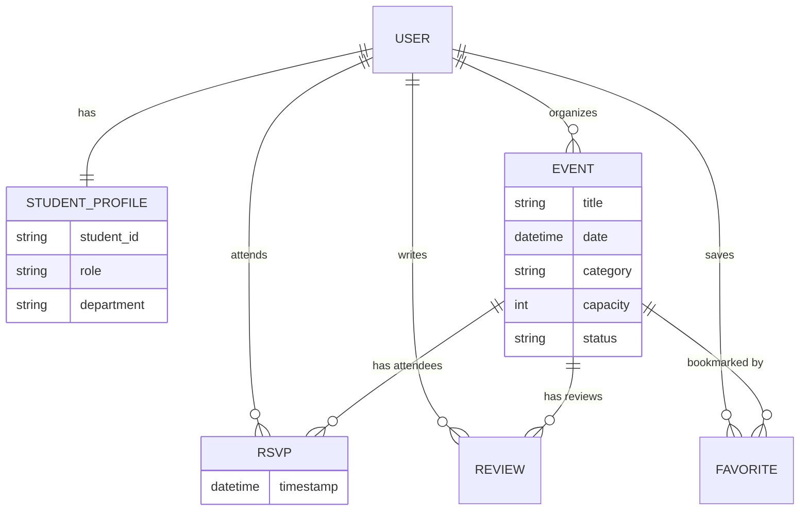

# Database Design & ER Diagram Summary

The **Campus Events Discovery App** uses a relational database schema (implemented in SQLite) to manage users, events, and their interactions.

## 1. Entity Relationship Overview

### Main Entities
1. **User (Django Built-in)**: The core identity for all participants.
2. **StudentProfile**: Extends User with role-based data (Student ID, Dept, Role).
3. **Event**: The central entity containing event details (Title, Date, Category).
4. **RSVP / EventRegistration**: The relationship mapping users to events they will attend.
5. **Review**: Allows students to provide feedback on events.
6. **Favorite**: Stores a user's bookmarked events.

## 2. Table Schema & Relationships

### Event Table
- **Primary Key**: ID
- **Fields**: Title (String), Description (Text), Date (DateTime), Location (String), Category (Choice), Image (File), Capacity (Int), Status (Choice: Pending/Approved/Rejected).
- **Foreign Key**: `organizer_id` -> User.id (One-to-Many).

### StudentProfile Table
- **Foreign Key**: `user_id` -> User.id (One-to-One).
- **Fields**: StudentID, Department, Year, Role (Student/Organizer/Admin).

### RSVP / Registration Table
- **Foreign Key**: `user_id` -> User.id.
- **Foreign Key**: `event_id` -> Event.id.
- **Unique Constraint**: A user can only RSVP once per event.

### Review Table
- **Foreign Key**: `user_id` -> User.id.
- **Foreign Key**: `event_id` -> Event.id.
- **Fields**: Rating (1-5), Comment (Text).

## 3. Visual Relationship Map (Mermaid)

---
*Documenting the backbone of the Campus Events system.*
